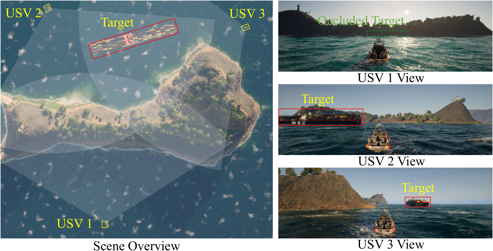
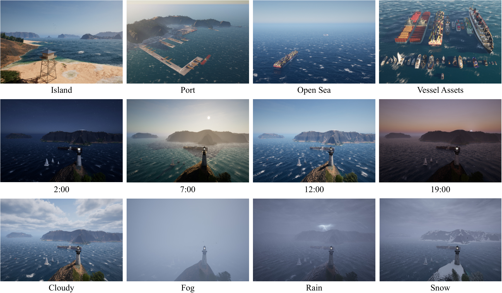
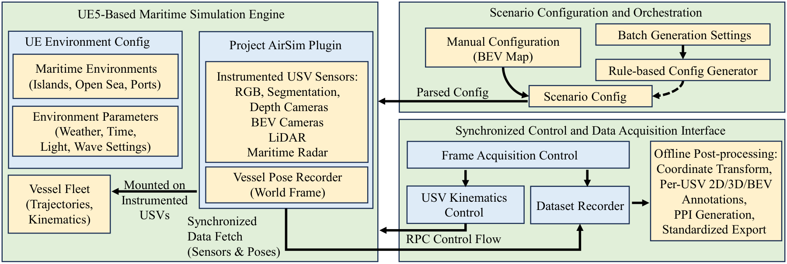
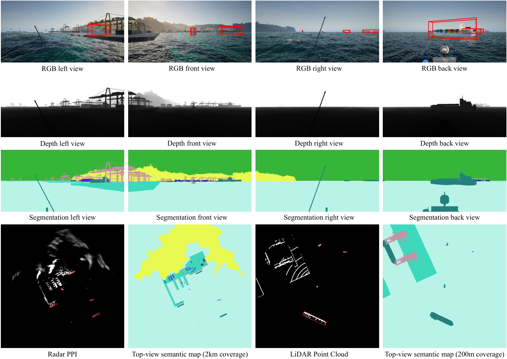
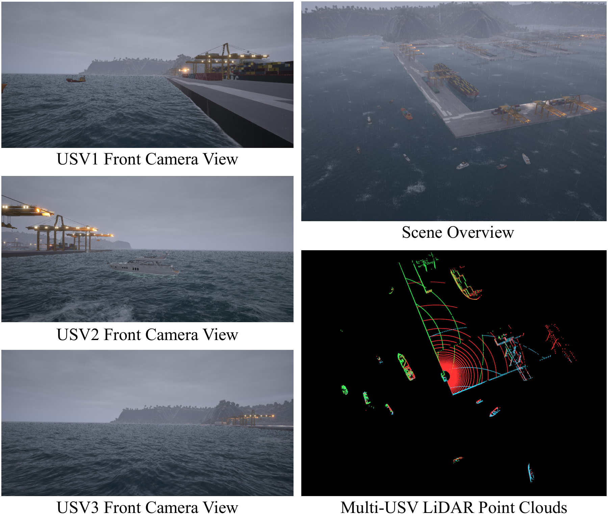

<h1 align="center">MMUSV-Sim: A Maritime Simulation Platform for Multi-USV Cooperative Perception</h1>

<a href="https://arxiv.org/abs/2608.14207">arXiv:2608.14207</a>

## Overview

Islands, port infrastructure, and nearby vessels can hide targets from an individual unmanned surface vehicle (USV). **MMUSV-Sim** provides a controlled environment for studying how multiple USVs can share complementary observations and perceive vessels beyond a single viewpoint.

Built on **Unreal Engine 5 and Project AirSim**, the platform connects configurable maritime scenarios, synchronized multimodal sensing, and annotations in a shared world frame. It supports three parts of this project:

- **Simulation:** configure environments, vessel fleets, trajectories, and sensors.
- **MarU2U-200m:** generate synchronized multi-USV RGB-LiDAR observations for cooperative perception.
- **Benchmarking:** evaluate cooperative bird's-eye-view (BEV) vessel detection, including pose errors and communication delays.

  

*Complementary viewpoints reveal a vessel occluded from USV 1. Observations from the three USVs can be aligned in a shared BEV frame.*

> The demo and project figures are available now. The simulator, dataset, and code are being prepared for release; see the [release progress](#release-progress) below.

## Demo

<!-- DEMO_PLAYER_START -->

https://github.com/user-attachments/assets/82407169-73d3-4c01-ad81-3132278c449d

<!-- DEMO_PLAYER_END -->

Play the complete demo above in **720p**, or [download the original 1080p MP4](https://raw.githubusercontent.com/lizaowo/MMUSV-Sim/main/media/MMUSV-Sim_Demo.mp4).

The **1:51 demo** covers maritime environments and weather, synchronized sensing and annotations, cooperative vessel detection, and examples with collaborator pose errors and communication delays. It has English on-screen captions and no audio. Detection sequences play at 2x speed where labeled.

## Simulator

### Maritime environments and vessel fleets

Create scenarios in **island, open-sea, and port** environments with configurable time of day, weather, illumination, and wave settings. A library of more than 30 vessel assets supports varied target sizes, layouts, and occlusion conditions. Vessel trajectories and sensors can be specified through manual configurations or rule-based batch generation.

  

### From scenario configuration to annotated observations

The acquisition interface coordinates vessel motion and records sensor observations and poses from the same paused scene state. Offline processing transforms vessel geometry into each agent's sensor frames and produces 2D, 3D, and BEV annotations.

  

### Sensor visualizations

The configurable sensor suite includes surround-view RGB, depth, semantic segmentation, top-view cameras, LiDAR, and ray-cast maritime radar. Vessel motion is kinematic, with synthetic heave, roll, and pitch for perception data generation.

  

*Sensor and annotation visualizations (Fig. 4): surround-view RGB images, depth maps, semantic segmentation, radar PPI, top-view semantic maps, and a LiDAR point cloud.*

MarU2U-200m uses the synchronized RGB-LiDAR configuration described below.

## MarU2U-200m Dataset

MarU2U-200m is a simulated cooperative vessel perception dataset with **2-4 instrumented USVs per sequence** and a **200 m LiDAR range**. Each scene frame groups all agents' observations at a common acquisition index, together with the poses needed for spatial alignment.

| Dataset statistic | Count |
| --- | ---: |
| Multi-USV sequences | 341 |
| Synchronized scene frames | 14,385 |
| Per-agent records / LiDAR sweeps | 33,525 |
| RGB images | 134,100 |

Each instrumented USV carries four surround-view RGB cameras (1024 x 512, 90-degree field of view each) and a 64-channel LiDAR with 360-degree horizontal coverage. Both modalities are captured at 5 Hz. The sequence-level split contains **239 training, 34 validation, and 68 test sequences**.

  

*A synchronized sample: camera observations from three USVs and their registered LiDAR point clouds. Red, green, and blue points identify the contributing USVs.*

## Cooperative Perception Benchmark

The benchmark evaluates BEV vessel detection with **LiDAR** and **RGB-LiDAR** inputs. It compares a single-USV baseline with early, intermediate, and late fusion, and examines performance across target scales and ranges, collaborator pose errors, and temporal delays.

Selected results on the MarU2U-200m test set are shown below. AP@0.5 is reported as a percentage.

| Method | Fusion | LiDAR AP@0.5 | RGB-LiDAR AP@0.5 |
| --- | --- | ---: | ---: |
| Single USV | None | 64.26 | 63.35 |
| Late Fusion | Late | 77.14 | 76.96 |
| Early Fusion | Early | **81.46** | **81.98** |
| F-Cooper | Intermediate | 69.00 | 73.55 |
| AttFusion | Intermediate | 71.14 | 74.09 |
| Where2comm | Intermediate | 73.88 | 74.75 |

Early Fusion improves LiDAR AP@0.5 by **17.20 percentage points** over the single-USV baseline. Adding RGB features improves the evaluated intermediate fusion methods, with the largest gain of **4.55 points** for F-Cooper.

## Release Progress

- [x] Paper
- [ ] Simulator executable
- [ ] Dataset
- [ ] Benchmark
