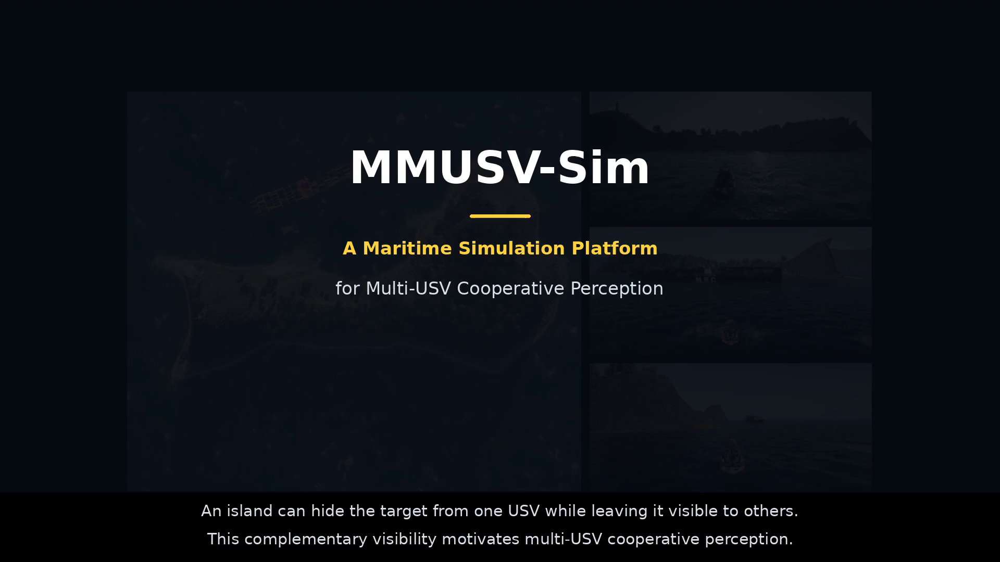

# MMUSV-Sim

**A Maritime Simulation Platform for Multi-USV Cooperative Perception**

Ziao Li1, Jianxiong Ye1, Biao Tang1, Leping Zhang2, Kun Zuo1, Siyu Huang1, Mengtang Li1, Deyu Meng3, and Chenqiang Gao1

1 School of Intelligent Systems Engineering, Sun Yat-sen University  
2 School of Intelligent Imagery Engineering, Beijing Film Academy  
3 School of Mathematics and Statistics, Xi'an Jiaotong University

MMUSV-Sim is a maritime simulation and data-generation platform for multi-USV cooperative perception, built on Unreal Engine 5 and Project AirSim. It supports configurable island, open-sea, and port environments, synchronized multimodal observations, and vessel annotations derived from a shared world frame.

## Video demo

[Open the demo](media/MMUSV-Sim_Demo.mp4) | [Download the MP4](https://raw.githubusercontent.com/lizaowo/MMUSV-Sim/main/media/MMUSV-Sim_Demo.mp4)

The 111-second demo includes:

- Maritime environments, vessel assets, weather, and time-of-day settings.
- Synchronized multi-USV sensing and multimodal observations and annotations.
- Cooperative vessel detection with LiDAR and RGB-LiDAR inputs.
- Examples with collaborator pose errors and communication delays.

The video uses English on-screen captions and has no audio. Detection sequences are shown at 2x playback, as labeled. Format: H.264 MP4, 1920 x 1080, 30 fps.

## Release status

This repository currently provides the project overview and video demo.

| Resource | Status |
| --- | --- |
| Video demo | Available |
| Unreal Engine project and source | Not yet released |
| MarU2U-200m dataset | Not yet released |
| Data acquisition and annotation code | Not yet released |
| Training and evaluation code | Not yet released |

The remaining resources are being prepared. No release date has been announced.
